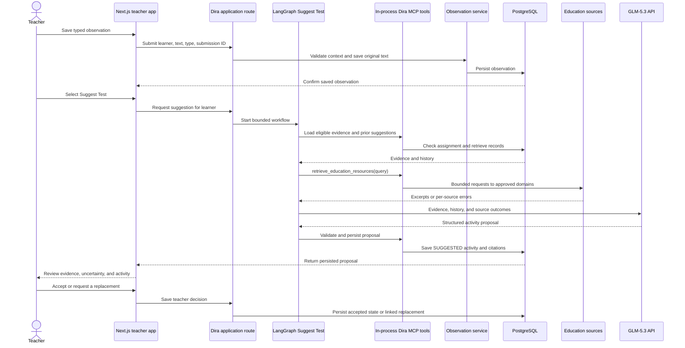
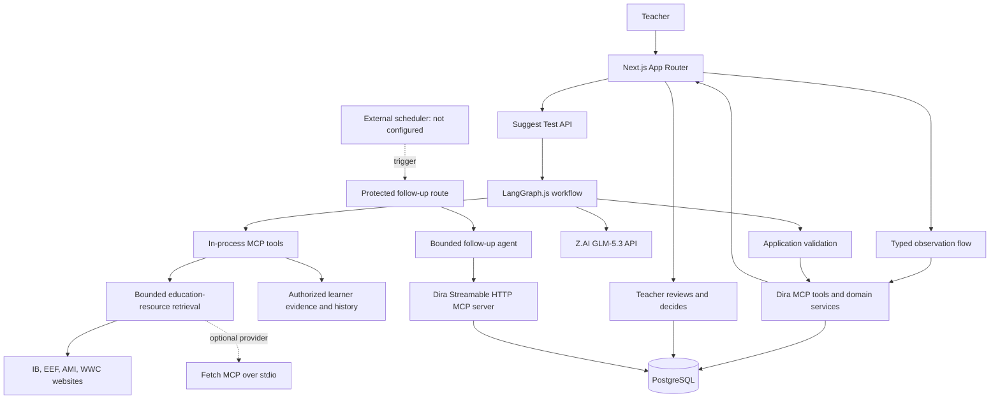

# DIRA — Making Every Learner Visible

**DIRA** is a teacher-focused classroom observation and early pathway-guidance
prototype. It helps teachers keep a traceable record of learner observations,
explore questions with small classroom activities, and review the resulting
evidence over time. DIRA suggests; the teacher decides.

> Every learner deserves to be seen before their potential becomes impossible
> to ignore.

## Contents

- [The problem](#the-problem)
- [The approach](#the-approach)
- [Who DIRA is for](#who-dira-is-for)
- [What is implemented](#what-is-implemented)
- [How a teacher uses DIRA](#how-a-teacher-uses-dira)
- [Architecture](#architecture)
- [Agent workflow](#agent-workflow)
- [MCP in DIRA](#mcp-in-dira)
- [Technology](#technology)
- [Set up a local demo](#set-up-a-local-demo)
- [Configuration and optional integrations](#configuration-and-optional-integrations)
- [Tests and verification](#tests-and-verification)
- [Human judgement and safety](#human-judgement-and-safety)
- [Limitations and known gaps](#limitations-and-known-gaps)
- [Business model](#business-model)
- [Future improvements](#future-improvements)
- [Contributing and project references](#contributing-and-project-references)
- USE LEARNER L003 - JAMES KIPCHOGE SYNTHETIC DATA TO TEST THE SUGGEST TEST FLOW (MEETS CRITERIA FOR SUGGESTING TEST)

## The problem

In a class of 40–80 learners, teachers may readily notice the children who are
excelling or struggling. Learners in between can be harder to follow over
several years—not because teachers do not care, but because one teacher cannot
continuously track every learner. Interests, aptitudes, and changing needs may
go unrecorded until useful opportunities for guidance have passed.

## The approach

DIRA turns everyday teacher observations into a reviewable evidence trail and
small, practical questions to explore in class. It is designed around three
constraints identified in teacher feedback:

- Support large classes without adding an onerous record-keeping task.
- Fit into ordinary teaching and observation workflows.
- Work toward accessibility beyond smartphones and dependable internet.

The current prototype supports typed observations, learner records, an
on-demand evidence-grounded activity suggestion, and an Evidence Card. It does
not yet deliver every intended low-connectivity or voice-capture capability.
DIRA does not label learners, prescribe careers, or claim to predict a learner's
future. It is intended to help teachers notice possibilities, challenge
assumptions, and start informed, age-appropriate conversations about future
subjects and pathways.

## Who DIRA is for

- **Primary users:** primary-school teachers working with large classes and
  school leaders supporting learner development.
- **Beneficiaries:** learners whose emerging interests and aptitudes might
  otherwise go unnoticed.

The current application is teacher-facing. It does not require or claim that
learners operate the software.

## What is implemented

| Capability | Current status |
|---|---|
| Learner list, weekly focus list, and learner record | Implemented in the Next.js application; reads the configured PostgreSQL demo dataset. |
| Typed observation capture | Implemented through the learner's Log Observation screen and persisted to PostgreSQL. |
| Observation review | Review controls are available for records marked as awaiting teacher review. |
| Suggest Test | Implemented as an on-demand LangGraph.js workflow; validates and persists a `SUGGESTED` activity with evidence links. |
| Teacher decision | The learner record lets a teacher accept a suggestion or reject it and request a linked replacement. Acceptance is not completion. |
| Evidence Card | Implemented at `/evidence/[learnerId]`; presents saved evidence and generated reasoning for teacher review. |
| Dira-owned MCP server | Implemented at `/api/mcp/server`; local smoke evaluation discovered 13 tools and invoked education retrieval. |
| Scheduled follow-up agent | Agent and protected trigger route are implemented, but no hosting scheduler is configured. |
| In-app microphone/transcription | Not connected. The observation composer disables voice capture. |
| Keeper calendar MCP | Client/helper foundation exists; OAuth callback, secure token storage, and a live authenticated call are not verified. |
| Optional Fetch MCP retrieval provider | Implemented as an optional backend; live Fetch MCP/PostgreSQL integration is not fully verified. |

The project distinguishes implementation from verification: passing mocked
tests does not prove that a live model, external website, phone provider,
calendar account, or production deployment works. More detail is in
[`EVALS.md`](./EVALS.md) and
[`README-INTEGRATION.md`](./README-INTEGRATION.md).

## How a teacher uses DIRA

1. Open **This Week** (`/this-week`) to see up to ten currently enrolled
   learners ordered by observation recency, or open **Learners** (`/learners`)
   to choose a learner.
2. From a learner record (`/learners/[learnerId]`), open **Log Observation**
   (`/learners/[learnerId]/log-observation`), choose a category, type the
   observation, and save it. The application preserves the teacher's text;
   voice input is currently disabled.
3. Review the learner's recent observations and their review status. Where
   required, confirm or update a recorded observation before it is eligible
   for suggestion reasoning.
4. On the learner record, select **Suggest Test** to request a classroom
   activity. DIRA retrieves eligible learner evidence and previous suggestions,
   attempts bounded educational-resource retrieval, generates a structured
   proposal, validates its citations and shape, and saves it before returning
   it for review.
5. Inspect the exploration question, proposed activity, cited observations,
   resource outcomes, and limitations. The teacher can set a planned date and
   accept, or reject the proposal and ask for a linked replacement.
6. If the teacher tries an accepted activity, record what happened as a new
   observation and link it to the test where appropriate. Review the Evidence
   Card again as further evidence is collected.

Suggestion generation requires a configured Z.AI key and may return an
explicit failure or insufficient-evidence result. External education sources
can be unavailable; their status is shown rather than replaced with invented
citations. The Evidence Card route is implemented, but it should be treated as
teacher-facing generated reasoning—not a definitive or validated assessment.



## Architecture



The Next.js App Router serves the teacher UI and server routes. PostgreSQL is
the system of record for learner context, observations, activity tests, linked
outcomes, and related workflow records. The Suggest Test graph uses MCP tools
over the official SDK's in-process transport to retrieve and persist Dira data;
it does not make recursive HTTP calls to Dira's public MCP endpoint.

Education-source retrieval is a bounded service. It restricts source domains
and returned content, and reports a result per configured source. Fetch MCP is
an optional extraction provider behind that service; Dira retains source
selection, URL checks, relevance ranking, and response validation.

The scheduled follow-up agent is a separate workflow. A hosting scheduler would
call the protected internal route; the agent then discovers and calls a limited
set of Dira MCP tools. The route exists, but a scheduler is not supplied or
configured by this repository.

## Agent workflow

The teacher starts Suggest Test for one selected learner; DIRA does not
automatically scan the whole roster or generate a suggestion at login. The
workflow:

1. Resolves the trusted demo teacher context and checks the selected learner's
   current assignment.
2. Retrieves learner evidence and prior suggested, accepted, or completed
   activities. The graph prepares eligible reviewed evidence; pending-review
   observations are not sent to the model.
3. Builds a bounded query from grade/stream, observation category, and selected
   subject/activity context, then attempts to retrieve educational resources
   from the configured official source families.
4. Sends eligible evidence, history, and retrieved source outcomes to the
   server-side GLM-5.3 client. Raw learner observations and learner IDs are not
   sent to education websites.
5. Validates the structured response and its evidence/resource references. It
   retries invalid generated output at most once and does not save a
   deterministic fallback if the model fails.
6. Persists a valid proposal and its evidence links as `SUGGESTED`; the teacher
   then reviews it and decides whether to accept it or request another.

This model-assisted reasoning is distinct from deterministic application
logic: authorization, evidence eligibility, schema checks, state transitions,
idempotency, and persistence are enforced by application code. A separate
scheduled GLM-5.3 agent handles queue-preparation or due-dispatch triggers. Its
tool set and run are bounded (at most four model turns and eight tool calls),
and it is not authorized to invent teacher observations.

## MCP in DIRA

**Model Context Protocol (MCP)** gives DIRA a standard way to expose
well-defined application tools and for an MCP client to discover and invoke
them. DIRA uses MCP internally between the Suggest Test graph and its
supporting tools, and externally through its own authenticated server endpoint.
An external HTTP API is not automatically an MCP server: GLM, transcription,
and Africa's Talking are provider APIs, while Keeper and the optional Fetch
provider use MCP.

### Dira-owned MCP tools

The public Dira server registers these **13 Dira-owned tools**. The endpoint is
`/api/mcp/server` and uses Streamable HTTP with a server-side bearer token.

| Tool | Main input | What it does / returns |
|---|---|---|
| `log_observation` | Learner ID, observation text/type/time, submission ID, optional context or linked test | Validates and saves teacher-provided text; returns the persisted observation ID and review status. It does not infer or rewrite the observation. |
| `suggest_test` | Learner ID and submission ID | Starts the Suggest Test workflow and returns a persisted proposal, citations, and retrieval status—or a structured failure/status. |
| `get_learner_observations` | Learner ID | Checks the trusted teacher's class assignment and returns learner observations and grade/stream context for evidence preparation. |
| `get_previous_suggestions` | Learner ID | Returns prior activity suggestions, statuses, dates, citations, and available reason fields. |
| `retrieve_education_resources` | Bounded query; no learner ID or raw observation text | Returns an overall retrieval status and one result/status per IB, EEF, AMI, and WWC source, including retrieved URLs/excerpts or bounded error details. |
| `persist_test_suggestion` | Learner ID, validated suggestion, submission ID, optional superseded test ID | Revalidates and saves one idempotent `SUGGESTED` activity and its evidence links. |
| `regenerate_test_suggestion` | Learner ID, prior proposal ID, submission ID, optional superseded test ID | Validates the saved proposal, reruns the workflow with history, and saves a linked replacement. |
| `accept_suggested_test` | Learner ID, proposal ID, planned date, submission ID, optional superseded test ID | Rechecks eligibility and updates the existing proposal to `ACCEPTED`; it does not mark it complete. |
| `build_evidence_summary` | Learner ID | Returns saved tests, linked evidence, retrieval outcomes, and teacher-recorded outcomes for the Evidence Card. |
| `prepare_daily_follow_up_queue` | No caller-supplied teacher identity | Idempotently creates eligible queue jobs for the server-resolved demo teacher; does not place calls. |
| `list_due_follow_ups` | Optional bounded result limit | Returns due queued jobs for the server-resolved demo teacher. |
| `dispatch_one_due_follow_up` | No caller-supplied teacher identity | Requests at most one dispatch after server-side schedule, destination, demo-mode, and atomic-claim checks. |
| `save_call_observation_drafts` | Recording ID and 1–30 transcript segments, with optional mentioned name/type | Saves quoted segments as unconfirmed observation drafts; learner matching is server-side and a teacher must review them. |

Tool schemas validate inputs before business logic. Tools return structured
results/errors and do not report a write as successful before persistence is
confirmed. The server resolves a single demo teacher; the caller cannot supply
its own teacher or school identity.

### MCP servers and verification status

| Server/component | Connection and purpose | Status |
|---|---|---|
| **Dira MCP server (owned)** | `POST /api/mcp/server`; official MCP TypeScript SDK, Streamable HTTP, bearer token; hosts the 13 tools above. | Tool discovery and a read-only retrieval invocation were exercised by `npm run mcp:test:external`. That run confirmed the MCP response shape, not successful source retrieval or production authentication. |
| **Suggest Test in-process MCP tools (owned)** | Official SDK `InMemoryTransport` between LangGraph nodes and the evidence/history/retrieval/persistence tools. | Mocked workflow tests are recorded as passing; live model and source access are separate dependencies. |
| **Fetch MCP (borrowed, optional)** | DIRA can launch the pinned `mcp-server-fetch==2026.10.10` with `uvx` over stdio when enabled. It is a retrieval backend, not a second learner-data workflow. | Optional provider/cache code and unit tests exist. The real Fetch MCP/PostgreSQL integration was not run because `uvx.exe` was unavailable in the recorded environment; do not treat it as end-to-end verified. |
| **Keeper.sh calendar MCP (borrowed)** | Client foundation uses the official MCP SDK and Streamable HTTP; tool calls are restricted to discovered tools marked read-only. | Not end-to-end integrated: OAuth callback handling, secure token persistence, per-teacher authorization, and a live authenticated call are absent/unverified. Calendar data is not part of Suggest Test. |

When MCP access is not configured, the Dira HTTP endpoint returns an explicit
service-unavailable response; a missing or invalid bearer token is unauthorized.
Tool failures are returned as structured errors. Source-level retrieval can
also fail while the MCP invocation itself succeeds: the response preserves the
per-source status. Timeouts, access restrictions, HTTP errors, extraction
failures, oversized content, and provider failures are not reported as
successful retrievals. The retrieval query can contain selected grade/stream,
subject, and activity-context values; avoid putting learner names or other
direct identifiers in those fields. Optional Fetch refresh failures can fall
back to Dira's independently validated direct retrieval; they do not make
stale cache entries fresh.

## Technology

| Area | Technology |
|---|---|
| Web application | Next.js App Router, React, TypeScript |
| Agent orchestration | LangGraph.js |
| MCP | Official MCP TypeScript SDK |
| Model | Z.AI GLM-5.3 API through a server-side model adapter |
| Durable data | PostgreSQL; PostgreSQL 16 in the local Compose setup |
| Input validation | Zod |
| Tests | Vitest |
| Optional external services | Fetch MCP, Keeper.sh calendar MCP, OpenAI audio transcription and Africa's Talking Voice where configured; these have different implementation and verification status (see below). |

## Set up a local demo

### Prerequisites

- Node.js and npm compatible with the project's Next.js 16 dependencies. The
  repository does not pin an exact Node.js release.
- Docker with Docker Compose for the provided PostgreSQL 16 development
  database.
- Python 3 (Windows `py -3`) only if generating and importing the synthetic
  demo dataset.
- `psql` only if applying the optional/manual database migration below.

### Install and start

In PowerShell:

```powershell
git clone https://github.com/Irene-Mukii/DIRA.git
Set-Location DIRA
Copy-Item .env.example .env.local
```

Edit `.env.local` locally. Set `DATABASE_URL` to the PostgreSQL development
database and `DIRA_DEMO_MODE=true` only for an isolated demo. Do not commit
`.env.local` or put real credentials in documentation. A Z.AI key is needed
for live suggestion generation.

Start the database and install packages:

```powershell
docker compose up -d --wait postgres
npm ci
```

The Compose service binds to `127.0.0.1:5433` and initializes a new volume with
the base schema and listed migrations. For agent-event extensions and the
optional Markdown cache, apply migration 009 to the local development database
after checking that this is the intended target:

```powershell
psql -h localhost -p 5433 -U dira_dev -d dira_dev -W -f db\009_agent_run_events_education_cache.sql
```

For an existing development database that does not yet have the
`agent_activity_logs` table, apply `db\002_agent_activity_logs.sql` first.
Migration 009 is not mounted by `compose.yaml`; PostgreSQL initialization
scripts only run for a newly initialized volume.

Generate, clean, and import synthetic records if the database does not already
contain demo learners:

```powershell
py -3 scripts/generate_synthetic_data.py --include-teacher-reviews --output-dir data/generated_day2
py -3 scripts/clean_dataset.py --input-dir data/generated_day2 --output-dir data/cleaned/generated_day2
```

The generated data includes deterministic L003 contradictory observations, a
`SUGGESTED` activity test, and a completed test with a linked outcome. It also
adds Amani to ordinary and exact-match first-name coverage. The cleaner validates
references and preserves the aligned supporting/contradicting evidence roles.

For an isolated local database, run:

```powershell
npm run db:seed:dev -- --input-dir=data/cleaned/generated_day2
```

For a Supabase evaluation target, create a **separate staging project** and apply
the schema and all required migrations before import. Never use the database URL
configured for the live Vercel deployment. Put only the staging connection URL
and project reference in ignored local `.env.local`:

```text
DIRA_STAGING_PROJECT_REF=<20-character Supabase project reference>
DIRA_STAGING_DATABASE_URL=<staging transaction-pooler URI with sslmode=require>
```

The staging importer accepts only the project's transaction pooler on port 6543
and requires the project reference to match the URL username and your explicit
confirmation. First validate the target configuration and dataset without
connecting to the database:

```powershell
npm run db:seed:staging -- --confirm-staging=<project-reference> --input-dir=data/cleaned/generated_day2 --check-only
```

Review the target and row counts, then run the same command without
`--check-only` to import. The importer uses one transaction and preserves
activity-test and teacher-review relationship rows. It refuses to write unless
all synthetic-data tables are empty; it never truncates tables. Use a fresh,
dedicated staging project for a new import rather than pointing this workflow at
production or clearing a populated database. Keep the importer-only
`DIRA_STAGING_*` values local; never configure them in Vercel. To view the staged
data in a hosted app, use a separate Vercel Preview deployment and set that
Preview environment's `DATABASE_URL` to the staging project. Keep Production
`DATABASE_URL` pointed at the production project.

Then start the local application:

```powershell
npm run dev
```

Open `http://localhost:3000`. The recorded demo data includes a learner at
`/evidence/L003`; actual available learners depend on the seeded dataset.

## Configuration and optional integrations

Use [`.env.example`](./.env.example) as the variable-name reference and keep
values in ignored `.env.local`. The principal settings are:

| Variable(s) | Used for | Notes |
|---|---|---|
| `DATABASE_URL` | PostgreSQL connection | Required for learner records and most tools. |
| `DIRA_DEMO_MODE` | Enables the development single-teacher demo context | Not production authentication; do not use with real learner data. |
| `ZAI_API_KEY` | GLM-5.3 model calls | Needed for live Suggest Test and model-assisted Evidence Card reasoning. |
| `DIRA_MCP_SERVER_URL`, `DIRA_MCP_ACCESS_TOKEN` | Scheduled agent's connection to Dira MCP | Server-side only. The same token is not per-user identity or authorization. |
| `FETCH_MCP_ENABLED`, `FETCH_MCP_COMMAND` | Optional Fetch MCP retrieval | Defaults off; `uvx` must be installed and visible to the Node server. On Windows, `FETCH_MCP_COMMAND` may point to `uvx.exe`. |
| `KEEPER_MCP_URL` | Keeper calendar MCP endpoint | A URL alone is insufficient; OAuth/session and secure token handling are not complete. |
| `FOLLOW_UP_SCHEDULER_SECRET` | Protects internal follow-up triggers | Required if an operator configures an external scheduler. |
| `AFRICASTALKING_USERNAME_VOICE`, `AFRICASTALKING_API_KEY_VOICE`, `AFRICASTALKING_VOICE_FROM`, `VOICE_CALLBACK_SECRET`, `DIRA_PUBLIC_BASE_URL` | Optional Africa's Talking Voice setup | Requires provider credentials, reachable callbacks, consent/configuration, and a safe demo destination. Live provider calls have not been verified. |
| `OPENAI_API_KEY`, `OPENAI_STT_MODEL` | MVP phone-call recording transcription path | Sends recording audio to OpenAI; review privacy/security before any real deployment. This does not enable the disabled in-app microphone. |
| `DIRA_STAGING_PROJECT_REF`, `DIRA_STAGING_DATABASE_URL` | Local-only Supabase synthetic-data importer | Keep only in ignored `.env.local`; never configure these in Vercel. |

The application also has a phone follow-up queue/dispatch and call-recording
callback implementation. Provider credentials and callbacks are not part of
minimum local setup; the live call and transcription path has not been
verified. Africa's Talking SMS credentials are not evidence of an implemented
SMS workflow.

For the Dira HTTP MCP smoke check, configure `DIRA_MCP_SERVER_URL` as
`http://localhost:3000/api/mcp/server` and set a private random
`DIRA_MCP_ACCESS_TOKEN` in the server environment, then run the app and:

```powershell
npm run mcp:test:external
```

This checks discovery and a read-only retrieval call. Do not expose
state-changing tools to untrusted clients.

To opt into Fetch MCP, install `uvx` first, set `FETCH_MCP_ENABLED=true`, and
optionally set `FETCH_MCP_COMMAND` to its full executable path. Retrieval also
requires outbound network access. The provider cannot bypass source access
restrictions. Its actual MCP/PostgreSQL integration remains unverified.

## Tests and verification

Available checks include:

```powershell
npm run test:suggest-test
npm exec tsc -- --noEmit
npm run build
```

`npm run test:suggest-test` covers the focused Suggest Test/evidence reasoning
suite with mocked providers. The repository's recorded evaluation reports 29
tests passed and one opt-in integration test skipped for that command. This
does not establish live provider or browser end-to-end behavior.

`npm run test:follow-ups` runs follow-up checks against the local Docker
development database. Set `DIRA_TEST_DATABASE_URL` in `.env.local` to the
loopback `dira_dev` database first; the test runner rejects other targets.
Dispatch is mocked in these tests and cannot place a real call.

The optional real Fetch MCP/PostgreSQL test requires a local development
database, `uvx`, and explicit opt-in:

```powershell
$env:RUN_FETCH_MCP_INTEGRATION = "true"
$env:FETCH_MCP_ENABLED = "true"
# Optional if uvx.exe is not on PATH:
$env:FETCH_MCP_COMMAND = "C:\path\to\uvx.exe"
npm run test:fetch-mcp
```

Do not interpret a skipped test as a pass. The recorded 2026-10-14 external
MCP smoke run discovered 13 Dira tools and returned a valid four-source
response, but all four live retrievals failed in that run (IB 403, EEF 404,
AMI response too large, and WWC extraction failure). See [`EVALS.md`](./EVALS.md)
for scenario-level results and untested cases.

## Human judgement and safety

DIRA supports teacher judgement; it does not replace it. A generated
developmental hypothesis is a question to explore, not a definitive assessment
of ability, interest, or career potential. Before acting, a teacher should
consider classroom context, alternative explanations, the quality and
recency of the evidence, and what further observation could clarify.

Observations remain teacher-provided records. Suggestions must cite real
eligible evidence; educational guidance is kept distinct from learner-specific
evidence. Accepting an activity records a plan, not a result. Only a
teacher-recorded outcome linked to the activity can contribute outcome evidence
for later review. Missing or conflicting evidence should be treated as a gap or
uncertainty, not as a learner deficit.

## Limitations and known gaps

- **Demo identity only:** the application resolves a single teacher from the
  development data. The Dira MCP endpoint uses a shared bearer token, not
  authenticated per-person authorization. Neither is suitable for real
  learner data.
- **No automatic scheduler:** the protected follow-up route and bounded agent
  exist, but an operator must configure and verify an external scheduler,
  secrets, retries, and duplicate-trigger handling.
- **Voice is incomplete:** the in-app microphone is disabled. Phone-call
  recording/transcription and Africa's Talking Voice code/configuration exist,
  but live calls, callbacks, audio handling, and transcription have not been
  verified end to end. The MVP transcription provider sends audio outside
  DIRA-controlled infrastructure.
- **Calendar is not operational:** Keeper client code exists, but OAuth
  callbacks, secure token persistence, teacher authorization, and a live call
  are not implemented or verified. Calendar information is not evidence that
  a lesson took place.
- **Education retrieval is environment-dependent:** the one recorded MCP
  smoke run returned source errors for all four domains. Fetch MCP needs
  `uvx`; its real integration was not run in the recorded environment because
  `uvx.exe` was unavailable. Retrieval success, speed, and source availability
  are not guaranteed.
- **Evaluation is incomplete:** automated tests cover selected mocked paths;
  conflicting-evidence handling, approval-bypass scenarios, full scheduled
  agent tool-selection behavior, and production authorization still need
  dedicated verification. No production-scale readiness is established.
- **Connectivity/accessibility goals remain work:** the repository does not
  establish a school-based offline server or reliable operation without
  connectivity.
- **Generated presentation needs review:** model-generated content may be
  verbose. Human review remains essential; generated language is not a
  validated educational assessment.

## Business model

The proposed adoption path is staged; these are business-model options, not
existing contracts or prices:

1. **School pilots and onboarding** with support for setting up teacher
   workflows and evaluating practical fit.
2. **Affordable annual school subscriptions** for schools using DIRA.
3. **County-level licensing and shared infrastructure** to support wider
   deployment and operational costs.
4. **Government, NGO, and education-partner deployments** for larger programs
   and shared implementation.

## Future improvements

- Replace the single-teacher demo resolver with secure, individual teacher and
  administrator authentication and authorization.
- Configure and verify an external scheduler, including its retry and
  duplicate-trigger policy.
- Complete calendar MCP OAuth and teacher-scoped authorization before using
  calendar context.
- Improve educational retrieval reliability and verify Fetch MCP with `uvx`
  and the PostgreSQL cache in a controlled environment.
- Complete an audio path with explicit teacher review and a privacy-reviewed,
  DIRA-controlled transcription option before real deployment.
- Expand scenario testing for conflicting evidence, insufficient evidence,
  state-dependent tool selection, and approval boundaries.
- Improve concise explanation of observed facts, tentative interpretations,
  evidence gaps, and alternatives in teacher-facing summaries.
- Validate low-connectivity and accessibility requirements in the intended
  school environments.

## Contributing and project references

See [`CONTRIBUTIONS.md`](./CONTRIBUTIONS.md) for contribution guidance.

- [System architecture](./SYSTEM_ARCHITECTURE.md)
- [MCP tool reference](./docs/reference/MCP_TOOLS.md)
- [User flows](./docs/reference/USER_FLOWS.md)
- [Safety and guardrails](./docs/reference/SAFETY_AND_GUARDRAILS.md)
- [Data model](./docs/reference/DATA_MODEL.md)
- [Integration and troubleshooting guide](./README-INTEGRATION.md)
- [Evaluation results and gaps](./EVALS.md)
