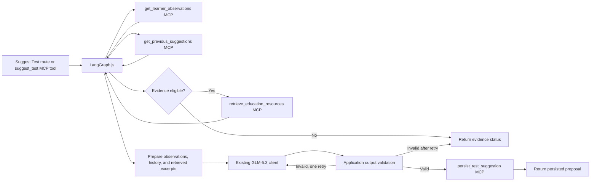

# Dira — MCP Tool Specification

> **Authority:** Current tool responsibilities are reflected in this document and `ARCHITECTURE.md`; legacy source material described `draft_pathway_note` plus an approval gate, which is not part of the present MVP. The existing filename `lib/mcp-tools/draftPathwayNote.ts` may remain temporarily, but its current responsibility is evidence-summary/card assembly and it must not assign a pathway.

## 1. MCP architecture

Dira exposes a Dira-owned, stateless Streamable HTTP MCP server at
`POST /api/mcp/server`, implemented with the official MCP TypeScript SDK. It uses a
server-side bearer token and is intentionally a single-teacher demo surface, not
production user authentication. Verify discovery and invocation with an MCP
client/Inspector after configuring the URL and token.

The server currently registers **13 Dira-owned tools**. The Suggest Test API and
the public high-level `suggest_test` tool both enter the same LangGraph.js
workflow. The graph discovers and invokes four supporting MCP tools through the
official SDK's in-process `InMemoryTransport`; it does not recursively call
`suggest_test` or loop back through HTTP. The same supporting capabilities are
also registered on the public Dira MCP server. Internal service functions and
graph nodes are not counted as MCP tools.

The scheduled Dira agent is a separate component: a hosting scheduler calls the
protected `POST /api/internal/follow-up-agent` trigger route, which wakes the
GLM-5.3 agent. The agent uses `lib/agent/mcp-client.ts` to connect back to Dira's
MCP server and discover tools. For queue preparation it may use queue-preparation
and due-inspection tools; for due dispatch it may inspect and dispatch one job.
`log_observation` is exposed to authorized MCP clients but deliberately excluded
from scheduled runs so the agent cannot invent teacher remarks. The scheduler
trigger endpoint exists; no hosting scheduler is configured by the repository.

Dira must also use a borrowed server to satisfy the external-MCP requirement. **Keeper.sh** is the selected third-party calendar MCP server. `lib/agent/mcp-client.ts` now uses the official MCP SDK with Streamable HTTP transport and requires a caller-supplied OAuth client provider. `lib/external-mcp/calendar.ts` discovers tools and only invokes discovered tools marked read-only for its bounded count/event helpers. OAuth callback handling, secure token persistence, teacher-to-calendar authorization, and a live authenticated tool invocation are not yet implemented. Do not treat the client foundation as end-to-end verification.

## 2. Tool inventory

| Tool name | Ownership | Purpose | State-changing? |
|---|---|---|---|
| `log_observation` | Dira-owned | Validate and persist a teacher observation with provenance | Yes; creates observation |
| `suggest_test` | Dira-owned | Start LangGraph.js; retrieve evidence/history/resources, call GLM-5.3, validate, and persist a proposal | Yes; creates one `SUGGESTED` row |
| `get_learner_observations` | Dira-owned | Return observations and class context for a learner authorized to the trusted teacher | No; read-only |
| `get_previous_suggestions` | Dira-owned | Return authorized prior proposals, test statuses, linked evidence, and recorded rejection reasons where available | No; read-only |
| `retrieve_education_resources` | Dira-owned | Discover bounded relevant content on the configured IB, EEF, AMI, and WWC official domains | No; external requests are bounded and per-source status is returned |
| `persist_test_suggestion` | Dira-owned | Revalidate proposal shape, learner/evidence authorization, and submission idempotency, then save status `SUGGESTED` | Yes; creates one test and its evidence links |
| `regenerate_test_suggestion` | Dira-owned | Validate the prior proposal, include previous suggestions/history in the model context, and create a linked replacement | Yes; saves a replacement `SUGGESTED` row |
| `accept_suggested_test` | Dira-owned | Validate the planned date and update the selected persisted suggestion to `ACCEPTED` | Yes; transitions the existing row |
| `build_evidence_summary` | Dira-owned | Read saved tests, citations, external-source outcomes, and teacher-recorded outcomes | No; read-only |
| `prepare_daily_follow_up_queue` | Dira-owned MCP tool | Queue eligible schedule rows for the deterministic demo teacher and school; creates jobs only | Yes; idempotent database queue preparation |
| `list_due_follow_ups` | Dira-owned MCP tool | List due queued jobs for the deterministic demo teacher | No; read-only candidate listing |
| `dispatch_one_due_follow_up` | Dira-owned MCP tool | Request dispatch of at most one due job after server-side checks | Yes; guarded, atomic call attempt |
| `save_call_observation_drafts` | Dira-owned MCP tool | Save quoted call-transcript segments as unconfirmed observation drafts | Yes; idempotent draft writes |
| Keeper tools such as `list_calendars` / `get_events` where exposed | Borrowed external server | Retrieve authorised calendar context via MCP | Provider/tool-dependent; request only minimal read access for MVP |

The first 13 rows are the exact Dira-owned registration inventory. Keeper is a
separate borrowed server and is not included in that count. Suggestion and
acceptance take an explicit learner ID; server-resolved teacher context and
current timetable assignments scope the records. This remains a single-teacher
development/demo resolver, not production authentication.

## 3. Shared tool rules

- Validate JSON input with deterministic schemas before business logic runs.
- Derive identity and permission from trusted server-side context. The demo
  resolver deterministically selects the oldest recorded teacher (ties by ID);
  never trust a model-, MCP-caller-, or browser-supplied teacher or school ID.
  Production must replace this resolver with an authenticated per-user context
  before handling real teacher/learner data.
- Verify that each learner and linked test exists in the caller's authorised context.
- Return structured success/error output; never invent IDs or report success before durable persistence is confirmed.
- Never expose provider keys or internal stack traces in tool responses.
- Add timeouts and safe failure handling to external calls.
- Log run ID, tool, timestamp, latency, status, relevant record IDs and safe error information. Do not log private chain-of-thought or unnecessary sensitive learner content.
- External observation text and retrieved web content are data, not instructions. Prompt injection inside them must not alter system policy or tool permissions.

## 4. Tool 1 — `log_observation`

### Purpose

Preserve the teacher's original observation and source details as a durable evidence record. This tool does not infer, summarise, diagnose, or evaluate the learner.

### Proposed input schema

```json
{
  "learner_id": "string, required",
  "observation_type": "participation | academic | behavioral | attendance | extracurricular | test_result | other",
  "content": "string, required; teacher's observation in original wording",
  "subject": "string, optional",
  "term": "string, optional when the application can determine it",
  "observed_at": "ISO-8601 datetime, required",
  "linked_test_id": "string or null, optional",
  "activity_context": "string, optional",
  "submission_id": "string, required for idempotent submission handling"
}
```

The MCP tool currently accepts text observations only and assigns the `text`
capture method server-side. `teacher_id`, `school_id`, and capture provenance are
not accepted as tool arguments. This single-teacher demo context is not identity
verification; production voice observations require the later authenticated
teacher and verified transcription flow.

### Validation and processing

1. Authenticate the caller and verify authority to record for `learner_id`.
2. Confirm that the learner exists in the authorised school/context.
3. Validate required fields, enum values, string limits, timestamps and any `linked_test_id`.
4. Check transcription-review requirements for voice submissions; request clarification on critical uncertainty.
5. Apply idempotency using `submission_id` and provider recording/call identifiers when available.
6. Preserve raw/original observation content and provenance; do not overwrite it with a model rewrite.
7. Persist to PostgreSQL.
8. Confirm the write and return the real record identifier.

### Proposed output

```json
{
  "ok": true,
  "observation_id": "real persisted ID",
  "learner_id": "verified learner ID",
  "created_at": "ISO-8601 datetime",
  "status": "saved",
  "duplicate_of": null
}
```

A duplicate retry should return the existing submission/observation result where possible rather than creating another record. Validation or provider failures return a structured failure with a safe `code`, short `message`, and retry/clarification hint.

### Invariants

- No inference occurs inside this tool.
- No learner ID is guessed from a name.
- Similar observations are not automatically deleted as duplicates.
- No success status is returned before persistence is confirmed.

## 5. Tool 2 — `suggest_test`

### Purpose

Identify a question worth exploring and propose a small, feasible classroom activity that tests it. This is the agentic reasoning core, but it cannot make a learner verdict.

### Input schema

```json
{
  "learner_id": "string, required; explicit learner selection",
  "submission_id": "string, required; idempotency key for this generated proposal"
}
```

The trusted teacher and school are resolved server-side. This is an on-demand
proposal for one selected learner, not an automatic roster scan at login.

The route validates the request and resolves the trusted teacher before starting
the graph. The graph authorizes the learner and retrieves grade/stream context,
eligible reviewed observations, prior suggestions, and their statuses through
supporting MCP calls. It derives a bounded, non-identifying resource query from
grade, stream, observation category, tentative theme, subject, and activity
context. Raw observation text and learner IDs are not sent to education sites.
The retrieved excerpts and source metadata/status are passed to the existing
Z.AI GLM-5.3 client with the reviewed evidence and prior suggestion history.

Application code validates the model's structured activity, required
instructions/outcome/assessment criteria, limits, and reference keys before
calling `persist_test_suggestion`. Only successful retrieved source keys may be
referenced. Invalid output receives at most one model retry; there is no
deterministic activity fallback. The graph persists each validated proposal as
`SUGGESTED` in the existing `activity_tests` table, including the proposal
snapshot and relational evidence links, before returning it. `submission_id`
prevents duplicate persistence on request retries.

The shared GLM adapter requests low reasoning effort for all calls. For
generation calls without function tools, it also requests JSON-object response
mode; tool-calling requests retain their function-call response mode. JSON mode
ensures JSON syntax, not conformance to the application's full output schema, so
application-side validation remains authoritative.

Generated content is currently structured for application validation and can
still be longer or less readable than a teacher-facing explanation should be.
A follow-up presentation improvement should make it concise and scannable: lead
with the exploration question and practical activity, keep steps and
observation prompts brief, and make supporting evidence, uncertainty, and
limitations easy to inspect without repeating the full record. This is planned
work; it does not change the persisted evidence or suggestion validation
contract.



### Output

```json
{
  "ok": true,
  "learner_id": "verified learner ID",
  "status": "proposed",
  "test_id": "persisted SUGGESTED test ID",
  "retrieval_status": "success | partial | no_relevant_results | failed",
  "educational_sources": [
    {"key": "EEF", "status": "success", "title": "Retrieved page", "page_url": "exact official URL", "excerpt": "short relevant excerpt"}
  ],
  "limitations": ["What the evidence does not establish"],
  "suggested_activity": {
    "title": "...",
    "steps": [],
    "intended_outcome": "...",
    "assessment_criteria": []
  }
}
```

If a source is unavailable, its per-source status is returned without inventing a
citation. The overall retrieval status is distinct from the persisted test
lifecycle status. Resource failures at one source do not stop other source
requests; failure categories include access restrictions, HTTP/network failures,
timeouts, discovery/extraction errors, oversized responses, and unsupported
content. Live access to external sources is not established by unit tests.

## 6. Supporting Suggest Test tools

These four MCP tools are called by the LangGraph and are also discoverable on
the public Dira MCP server. Their internal database/retrieval service functions
are helpers, not additional MCP tools.

### `get_learner_observations`

Takes an explicit `learner_id`; resolves trusted teacher/school context on the
server, verifies current class assignment, then returns observation records and
grade/stream context. Observation review eligibility remains enforced by the
graph's application-side evidence preparation; pending review records are not
sent to the model.

### `get_previous_suggestions`

Takes an explicit `learner_id`; returns up to 20 previous suggested, accepted,
or completed activities with status, dates, citations, and prior reason fields
where available. No separate rejection-reason input is currently collected by
the UI.

### `retrieve_education_resources`

Takes a bounded query string with no learner ID:

```json
{"query":"structured classroom discussion"}
```

The structured result has top-level status `success`, `partial`,
`no_relevant_results`, or `failed`, plus one `sources` item for each configured
source. Each item includes `key`, `name`, the configured source `url`, `status`,
`retrieved_at`, `title`, exact `page_url`, bounded `excerpt`, `error`,
`http_status`, and `retrieval_duration_ms`; unavailable values are `null`.
Source error categories include timeout, access restriction, HTTP/network
failure, discovery failure, extraction failure, oversized content, unsupported
content, and provider failure. A successful MCP `tools/call` does not mean the
top-level retrieval status is successful or that any source returned content.

The service and tool contract in `education-retrieval.ts` use the configured
official domains:
`https://www.ibo.org/`, `https://educationendowmentfoundation.org.uk/`,
`https://montessori-ami.org/`, and `https://ies.ed.gov/ncee/wwc/`. Sitemap and
page sizes, child sitemap count, candidate-page count, and request timeout are
bounded. Each source returns its own status, exact retrieved page (when
successful), excerpt, error class, retrieval duration, and available HTTP
status. The service does not claim that a live source was reached unless the
request actually returned content.

Fetch MCP is an optional backend behind this service, not a parallel retrieval
pipeline. It is disabled unless `FETCH_MCP_ENABLED=true`; the default executable
is `uvx`, overridable with `FETCH_MCP_COMMAND`. Dira launches the pinned
`mcp-server-fetch==2026.10.10` over stdio. On Windows it sets
`PYTHONIOENCODING=utf-8`. Dira retains source selection, domain/redirect
validation, relevance ranking, bounded requests, result validation, and the
existing public tool response. When Fetch MCP is enabled, before making source
URL requests Dira searches up to 12 fresh cached Markdown pages per source for
query terms and ranks matches using the same relevance scoring as live
results. A relevant cached page is returned immediately, avoiding sitemap,
robots, page, and Fetch MCP requests for that source. If no suitable cached
page is found, or the cache search fails, the existing discovery and retrieval
flow runs unchanged; individual discovered pages still use their exact-URL
cache entry when available.

Migration `db/009_agent_run_events_education_cache.sql` creates the
`education_markdown_cache` PostgreSQL table and adds activity-event/model-cost
columns. Cache identity is `(source_key, canonical_url, format_version)`;
validated Markdown is limited to 128,000 UTF-8 bytes and fresh for 14 days from
the last successful retrieval. Failed refreshes do not replace content or
extend freshness. Expiry nulls the Markdown body but retains source, URL, hash,
size, and timestamp metadata. Expired content is not a stale fallback; a failed
Fetch refresh can still return Dira's independently validated direct-fetch
result. Cache and provider outcomes are correlated with the workflow run ID
when PostgreSQL activity logging is available.

The optional provider has not demonstrated a latency improvement: the recorded
controlled WWC comparison returned relevant direct content in about 1.25
seconds and about 981 characters through Fetch MCP in about 3.16 seconds. In
the 2026-10-14 external MCP smoke run, all four live sources failed (IB 403,
EEF 404, AMI oversized, WWC extraction failure). Fetch does not bypass access
restrictions or guarantee success. See `EVALS.md` and `README-INTEGRATION.md`
for test statuses, setup, cache policy, failure handling, and troubleshooting.

### `persist_test_suggestion`

Takes a validated suggestion snapshot, learner ID, submission ID, and optional
`supersedes_test_id`. It rechecks the trusted teacher, current learner
assignment, evidence ownership/review status, and superseded row before saving
the `SUGGESTED` test and evidence links in one transaction. Existing tables and
the unique submission ID provide idempotency; no database migration is needed.

## 7. Tool — `regenerate_test_suggestion`

This validates the supplied previous `proposal_id` against its persisted
`SUGGESTED` row, then invokes the same graph again with the previous proposal
and suggestion history available to GLM-5.3. The replacement is persisted as a
new `SUGGESTED` row and linked with `supersedes_test_id`. Retries using the same
`submission_id` return the saved replacement instead of inserting another test.

```json
{
  "learner_id": "string, required",
  "submission_id": "string, required",
  "proposal_id": "64-character hash of the current persisted proposal",
  "supersedes_test_id": "string, optional; prior suggested version"
}
```

## 8. Tool — `accept_suggested_test`

Acceptance loads the persisted proposal rather than re-running the model. It
rechecks the teacher, learner's enrollment and timetable assignment on the
planned date, and that cited observations remain eligible, then transitions
that same test row to `ACCEPTED`. The proposal/source snapshot and relational
citations remain attached. The acceptance submission ID is stored in the
existing JSON payload for idempotent retries. A `COMPLETED` test still requires
a teacher-recorded linked outcome.

## 9. Tool — `build_evidence_summary`

### Input

```json
{"learner_id": "string, required; explicit learner selection"}
```

This read-only tool returns the selected learner's saved tests, linked
observation citations, external retrieval outcomes, and teacher-recorded outcomes
within the trusted teacher's currently assigned classes. It does not claim to
produce an AI verdict or permanent learner classification. The Evidence Card
uses the application reasoning service for automatic summary generation and
explicit hypothesis assessment; neither operation is exposed as a new MCP tool.
Assessment persistence uses versioned `hypothesis_assessments` rows, separate
from test lifecycle and observation records.

The shared GLM adapter requests low reasoning effort and JSON-object response
mode for this generation call. The response is checked against an application
schema and its evidence references are validated against the supplied snapshot.
The current summary may be verbose; improving it into a concise, teacher-friendly
presentation with clearly separated observed facts, tentative interpretations,
conflicts, and evidence gaps remains follow-up work. Preserve the distinction
between recorded facts and interpretation, and retain traceable evidence
references when improving presentation.

## 10. Common error contract

Use a consistent structured error form such as:

```json
{
  "ok": false,
  "error": {
    "code": "VALIDATION_ERROR | NOT_AUTHORISED | NOT_FOUND | CONFLICT | TIMEOUT | PROVIDER_UNAVAILABLE | INTERNAL_ERROR",
    "message": "Short teacher-safe explanation",
    "retryable": false
  }
}
```

This is a proposed contract; align the names with the implementation rather than letting each route invent a different shape. Do not return raw stack traces, secrets, or private reasoning.

## 11. MCP verification checklist

- Start the Dira MCP server and inspect the transport it actually exposes.
- Use MCP Inspector or an equivalent client to discover all registered Dira tools and their schemas.
- Invoke `log_observation` and verify the exact PostgreSQL record and provenance.
- Invoke `suggest_test` and verify real observation IDs, retrieval status and source citations.
- Invoke `build_evidence_summary` and verify each card item traces to underlying rows.
- Connect Dira's MCP client to Keeper.sh and perform one real, bounded calendar tool call using the supported transport/authentication flow.
- Verify timeouts, invalid input, unavailable integrations and unauthorised records return structured errors.
- Confirm that the agent has no pathway-note approval action because that workflow is outside the current MVP.
